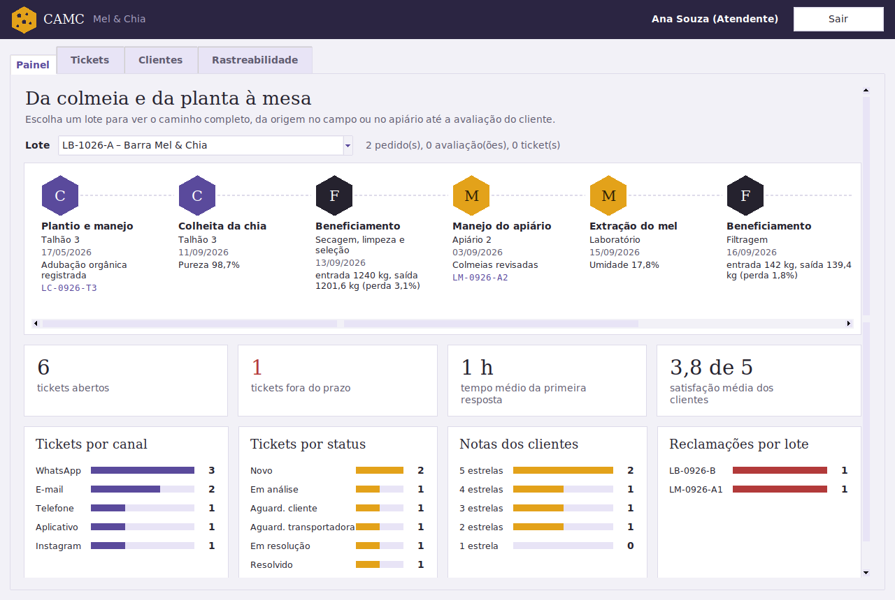
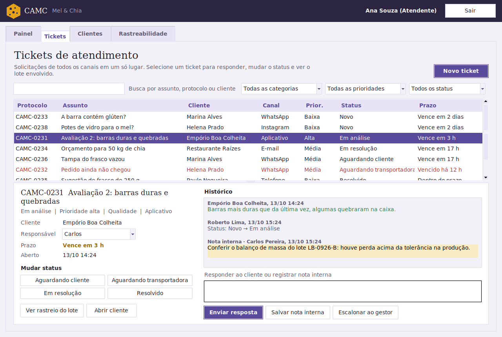
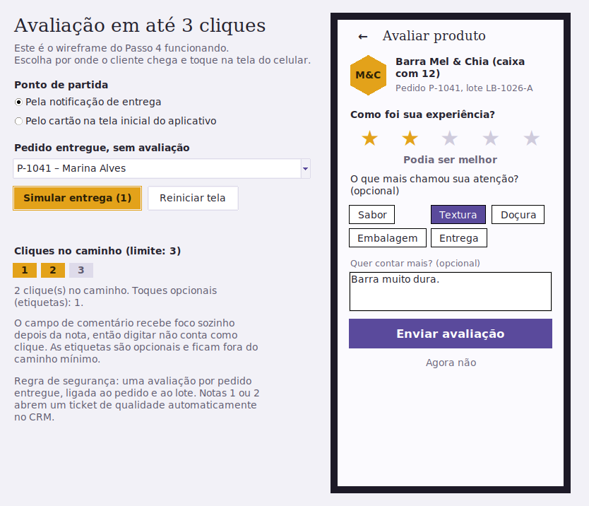
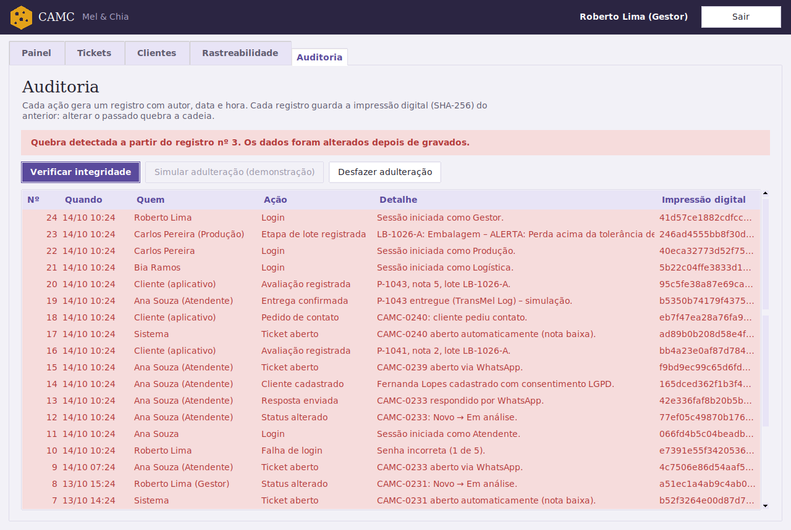

# CAMC – Sistema integrado (protótipo em Python)

Protótipo funcional do sistema descrito no Projeto Integrado (Análise e Desenvolvimento de Sistemas)
para a **CAMC – Cadeia Alimentar do Mel e Chia**: CRM com tickets, rastreabilidade por lote,
segurança e auditoria, e a tela de avaliação do cliente em até 3 cliques.

Tudo é feito só com a biblioteca padrão do Python (Tkinter + SQLite). **Não precisa instalar nada com pip.**
Todos os dados de exemplo são fictícios.

## Capturas de tela






## Como executar

Requisitos: **Python 3.8 ou superior** com Tkinter.

- **Windows:** o instalador do python.org já inclui o Tkinter. No terminal: `python main.py` (ou `py main.py`).
- **Ubuntu/Debian:** `sudo apt install python3-tk` e depois `python3 main.py`.
- **macOS:** `python3 main.py` (o instalador do python.org inclui o Tkinter; os botões do celular simulado podem ter cores nativas).

Na primeira execução o sistema cria a pasta `dados/` com o banco `camc.db` já com dados de exemplo.
Para recomeçar do zero, feche o programa e apague `dados/camc.db`.

## Usuários de demonstração

Senha de todos: `camc-demo-2026` (somente para demonstração; em uso real, cada pessoa troca a sua em *Arquivo > Trocar minha senha*).

| Login | Perfil | O que consegue fazer |
|---|---|---|
| `atendente` | Atendente | Clientes, tickets, histórico, anotações, rastreio, app do cliente |
| `gestor` | Gestor | Consulta, cria e edita tickets, anonimiza dados (LGPD), auditoria |
| `logistica` | Logística | Consulta; edita apenas tickets de **Rastreio** |
| `producao` | Produção | Registra etapas dos lotes (com balanço de massa) |
| `auditor` | Auditor | Somente leitura, mais a verificação da cadeia de auditoria |
| `admin` | Administrador de TI | Backup, teste de restauração e usuários; **não vê dados de negócio** |

## O que o protótipo cobre

| Passo do trabalho | No protótipo |
|---|---|
| 1 – Projeto de Software | Cadastro com CPF/CNPJ validado, detecção de duplicidade, consentimento LGPD; histórico unificado de canais, compras, tickets e avaliações; tickets com categoria, prioridade, SLA, responsável, escalonamento e fluxo de status; vínculo de pedido e lote; indicadores |
| 2 – Segurança e Auditoria | Perfis de acesso com menor privilégio, senha com PBKDF2 e bloqueio após 5 tentativas, trilha de auditoria com **hash encadeado (SHA-256)** e gatilhos que impedem UPDATE/DELETE, rastreabilidade por lote com balanço de massa, backup com hash e **teste de restauração**, anonimização (LGPD) |
| 4 – Interface e Usabilidade | Janela *App do cliente*: avaliação em até 3 cliques (notificação, estrela, enviar), nota 1 ou 2 abre ticket automático |
| Passos 3 e 5 (Redes e Arquitetura) | São projetos de infraestrutura e ficam nos documentos; o sistema roda em um único arquivo SQLite, que é o ponto de partida do servidor descrito no Passo 5 |

## Roteiro de demonstração (uns 5 minutos)

1. **Atendente:** aba *Tickets*, selecione `CAMC-0231`, clique em *Ver rastreio do lote* e veja a perda acima da tolerância na produção do lote `LB-0926-B`. Responda e mude o status.
2. **App do cliente** (*Arquivo > Abrir app do cliente*): toque na notificação, dê nota 2 e envie. Veja o contador de cliques e o ticket aberto automaticamente.
3. **Gestor:** aba *Auditoria*, clique em *Simular adulteração* e depois em *Verificar integridade* para ver a cadeia quebrar; desfaça em seguida.
4. **Produção:** aba *Rastreabilidade*, *Registrar etapa* com entrada 100 kg e saída 80 kg para ver o alerta de balanço de massa.
5. **Admin:** aba *Administração*, *Criar backup agora* e *Testar restauração do selecionado*.

## Estrutura

```
main.py              ponto de entrada
camc/banco.py        esquema SQLite e conexão
camc/seguranca.py    perfis, senhas, auditoria encadeada e backup
camc/servicos.py     regras de negócio (cada ação confere a permissão e grava na auditoria)
camc/interface.py    telas em Tkinter
camc/exemplo.py      dados de exemplo
tests/               testes automatizados
capturas/            imagens das telas
```

## Testes

```
python -m unittest discover -s tests -v     # 27 testes de regras, segurança e dados
xvfb-run -a python tests/ui_smoke.py        # percorre as telas (Linux; precisa de um display)
```

## Limitações (é um protótipo)

- Não há verificação em duas etapas, integração real com WhatsApp, e-mail ou transportadora, nem envio de backup para a nuvem.
- Os backups não são criptografados (a biblioteca padrão não tem AES). Em uso real, guarde-os em disco criptografado.
- SQLite atende bem a um usuário ou a poucos usuários na mesma máquina; para vários computadores simultâneos, o próximo passo é um banco de dados em servidor (como PostgreSQL), conforme o Passo 5.
- As metas de prazo (SLA), a tolerância de perda de 5% e os perfis são parâmetros de exemplo, para ajustar com a equipe da CAMC.
